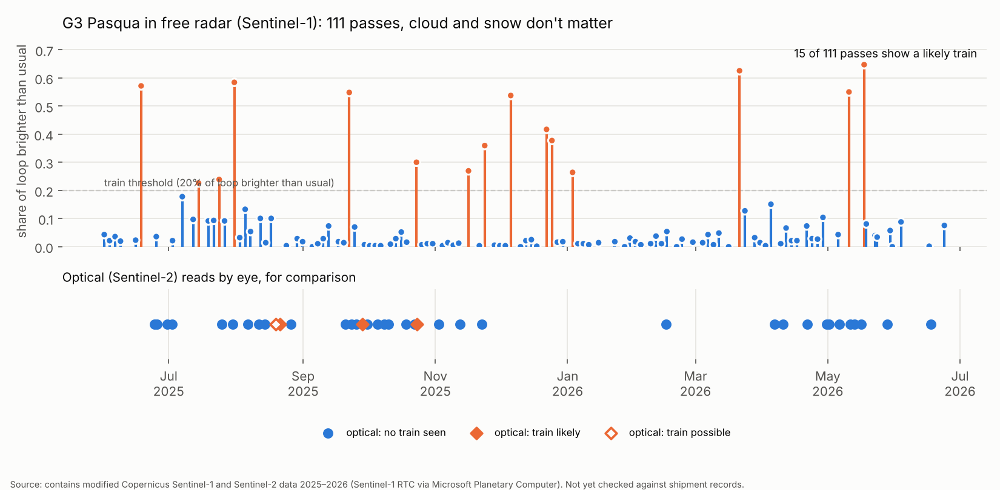
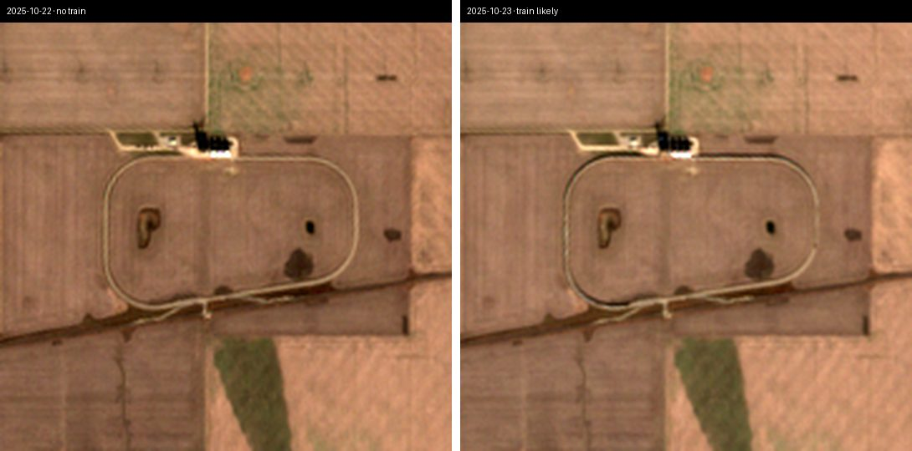
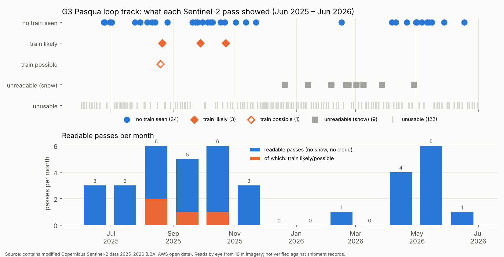

# Saskatchewan Rail Activity Signals: proof-of-concept findings

**Date:** 2026-11-06 · **Stage:** Spark → Brief (proof of concept) · **Crew:** Ines, with Juno's checklist · **Brandon's hours so far:** 0

---

## Update, same day: radar works at Pasqua

**Free radar (Sentinel-1) is much better than free photos.** Radar sees through cloud and works in the dark and in winter, and a string of steel hopper cars reflects it strongly.

- **111 radar passes over G3 Pasqua in 13 months**, every one usable, against 38 readable optical photos.
- **15 of 111 passes show a clear spike**: a long stretch of the loop suddenly much brighter than usual for that satellite track. Between spikes the loop is quiet. Five spikes fall in Nov–Dec 2025, when optical photos were blind.
- **Radar and optical agree on all 7 days they both imaged Pasqua**: 6 empty, 1 train. On 23 Oct 2025 radar saw the train at 7:07 a.m. and the optical photo still showed it at 11:40.
- **Belle Plaine is still inconclusive.** No clear spikes there either. Possible reasons: a quieter terminal, the wrong ring of track (the terminal may load on a separate track), or cars parked there most of the time, which would make "full" look normal.

**What this means for accuracy.** About 14% of passes catch a train (95% range roughly 8–21%). Yearly train counts still hinge on how long a train sits on the loop: at 12 hours that's roughly 60–180 trains a year, at 24 hours 30–90. **One conversation with a terminal manager about dwell time, plus a few known train dates, would turn this into a real number.** Accuracy still can't be stated until then.

**Spurs, not loops, are the majority** (Brandon's correction). The Grain Monitoring Program counts **92 Saskatchewan elevators that load 100+ cars: 68 on straight "ladder" spurs, 24 on loops**, plus 44 that load 25–99 cars (`data/sask_block_loading_elevators_gmp.csv`). The Grain Commission's named list (August 2026 edition) is on canada.ca, which refuses automated downloads, so the next step needs that file from Brandon. My stand-in list built from open map data (`data/terminal_candidates_unverified.csv`) is too noisy to use as-is: city yards and unrelated businesses crowd the top.

---

## Update 2: the official elevator list

Brandon supplied the Canadian Grain Commission's *Grain Elevators in Canada* (1 August 2026). Its Saskatchewan table is now a dataset: `data/cgc_licensed_elevators_sask_2026-08-01.csv`. That's **193 licences (161 primary, 32 process)**, and the parsed capacities total **4,644,817 t, exactly matching the PDF's own total**.

- **82 primary elevators of 25,000 t or more sit on a rail line.** These are the likely unit-train shippers, close to the Grain Monitoring Program's count of 92 that load 100+ cars.
- **Viterra's elevators are now licensed to Bunge** (post-merger). Earlier "Viterra" labels in this folder came from map data and are out of date.
- **Belle Plaine was the wrong site** (Brandon's correction). The only grain licences there are Bunge on CPKC (20,500 t, small) and the Co-op ethanol plant on CN. The loop I measured belongs to a business I haven't identified, which explains why neither optical nor radar showed grain trains there. See `img/belle-plaine-overview.jpg`.
- **Finding each elevator on the ground is the slow part.** Station names put me in the right town but not on the elevator, and rural Saskatchewan has few mapped building footprints (15 of 82 pinned automatically). A first look at the 10 m imagery classed 13 sites (`data/terminal_first_look.csv`): 8 ladder spurs, 5 loops, all tentative. 10 m imagery is too coarse to spot an elevator reliably from scratch. OpenStreetMap's own elevator tags would help, but its live search (Overpass) kept dropping the connection from this session.

---

## The short answer (first pass, optical only)

**Free satellite imagery can *sometimes* see a unit train at a grain terminal, but not reliably enough to build a site-level shipment dataset.** The idea doesn't hold up as specified on free data. It might hold up with one more free test (radar, below) or with paid 3 m imagery.

| Question | Answer |
|---|---|
| Can we find the terminals? | **Yes, quickly.** An open rail map gave every closed "loop" track in Saskatchewan in minutes; 12 sorted so far (3 confident grain terminals, 7 probable, 2 canola crush plants). |
| Is there enough free imagery? | **More than expected in summer, almost none in winter.** 169 Sentinel-2 passes over G3 Pasqua in 13 months, but only 38 were readable (no cloud, no snow on the loop). Dec–Mar: 0–1 readable passes a month, and that's peak shipping season. |
| Can we see a train? | **On a good day, yes, by eye** (see the picture below). My simple automatic score can't yet tell a train from harvest dust, haze and shadows. At the second site (Belle Plaine) I couldn't confidently see any train. |
| How accurate? | **Unknown.** I have no record of real train dates to check against. 3 likely trains in 38 readable passes gives a yearly estimate of **somewhere between ~6 and ~180 trains**. That range is too wide to sell. |
| Validated against public totals? | **No.** Public totals are network-wide or province-wide, so they can't check one site. The CGC, CN and CPKC websites were also blocked from this cloud session. |
| Regina siding (free high-res)? | **Not tested, and unlikely to work.** Free high-res archives refresh a given spot roughly once a year, which can't show weekly car swaps, and their licences forbid selling data derived from them. |
| Cost to scale on paid imagery | Roughly **US$5k minimum order, then tens of thousands a year** for near-daily 3 m coverage of 20 terminals. Quotes needed; see below. |

*G3 Pasqua, 22 vs 23 October 2025, Sentinel-2 at 10 m. On the 23rd a dark line traces the inside of almost the whole loop: very likely a full unit train. This is about as clear as it gets.*

---

## What I did, in plain language

Think of it as **a trail camera that takes one photo a day at about 11:40 a.m.** You don't see every train; you see whether a train happens to be sitting there when the shutter clicks. Do that all year and you learn *how often the loop is busy*, which hints at how many trains it ships.

1. **Found the loops.** Unit-train terminals have a racetrack-shaped loop about 2.5–3 km around. I pulled the open rail map for Saskatchewan (from Overture Maps, which repackages OpenStreetMap) and had the computer find every closed ring of track that size: 194 candidates, 26 worth a look. I then looked at each one in satellite imagery to sort grain terminals from potash mines, coal mines and crush plants (`img/loops-sheet-*.jpg`, `data/sites.csv`).
2. **Pulled every free image.** Sentinel-2 (EU Copernicus) imagery sits free on Amazon's servers. Three satellites are now flying, so a site gets a pass every 2–3 days, better than the 5 days we assumed.
3. **Straightened the loop.** For each pass I "unrolled" the loop into a flat strip, like peeling the label off a can, and stacked the strips by date. Empty track is a clean bright line; a train shows as a dark, beaded line (`img/pasqua-straightened-loop.jpg`).
4. **Read each pass by eye** and also scored it automatically ("how much of the loop is darker than the fields beside it"). The eye reads are the sample dataset; the automatic score sits alongside them for comparison.

*Every pass over G3 Pasqua, June 2025 to June 2026. Most passes are unusable (cloud). Winter, the busiest shipping season, is nearly blank.*

**Sample dataset:** `data/g3-pasqua_observations.csv` (169 rows, one per pass) and `data/viterra-belle-plaine_observations.csv`. Columns: date, scene, cloud and snow on the loop, two automatic scores, and my eye read.

---

## Assumptions that turned out wrong

1. **"~5-day revisit."** Wrong, in our favour: about every 2–3 days with three satellites. But cloud leaves ~1 readable pass in 4–5, and winter almost none.
2. **"A 2 km train is easy to see at 10 m."** Only partly true. The train is long, but a hopper car is 3 m wide, less than a third of one 10 m pixel. Visible on clear autumn days; easily confused with shadow, haze and harvest colour.
3. **"Estimate shipments per site."** Not as framed. A once-a-day photo measures *how often the loop is occupied*, not how many trains left. Turning that into a count needs the typical time a train sits on the loop, which we don't know (I assumed 12–24 h; a terminal manager would know).
4. **"Validate against public totals."** Weak by design. CGC and Grain Monitoring Program figures are national or provincial, so they can't check one site. Validation needs site-level truth from a terminal or a railway.
5. **"Free high-res history can show car swaps at the Regina siding."** Very likely wrong. Esri Wayback has ~12–19 releases a year worldwide, but any one spot usually gets new imagery only about once a year (I couldn't check Regina's actual dates from here). Google Earth is similar. Both licences forbid building commercial data from them.
6. **"The Regina crusher."** Ambiguous at first. **Brandon confirmed (2026-11-06) it's the Cargill canola crush plant** at the Global Transportation Hub, which sits on a loop, not an aggregate siding.
7. **"Nobody has site-level data."** True *publicly*, but the Ag Transport Coalition already gets weekly car data from shippers covering ~90% of grain traffic, through Quorum's affiliate QGI ([source](https://m.farms.com/news/grain-deliveries-by-canada-s-two-major-railways-strong-in-week-10-ag-transport-coalition-233960.aspx)). Grain companies and railways already know their own numbers. The gap is for **outsiders**: traders, analysts, lenders, government.

---

8. **"Terminals load on loops."** Wrong (Brandon, 2026-11-06). Many terminals load on straight spurs, so searching for loops finds only a minority. Next pass starts from the Canadian Grain Commission's list of licensed elevators and identifies each one.

---

## What it would cost to scale

| Option | What you get | Cost | Verdict |
|---|---|---|---|
| **Sentinel-2 (what we used)** | 10 m, every 2–3 days, free; commercial use allowed with attribution | $0 data; ~15 h/yr of eye-reading for 20 sites | Too weak a signal on its own |
| **Sentinel-1 radar (tested at Pasqua, same day)** | 10 m radar, ~2 passes a week from three satellites, through cloud, day or night | $0 data | **Works at Pasqua; inconclusive at Belle Plaine.** Use it as the main free signal. |
| **PlanetScope (3 m, near-daily)** | A car is a full pixel wide: train visible most clear days | Planet lists annual plans of US$2,700 / $5,100 / $9,650 ([planet.com/pricing](https://planet.com/pricing)); older reseller rates were US$1.28–1.80/km² with a US$5,000 minimum ([Apollo Mapping](https://apollomapping.com/blog/new-minimum-order-size-medium-resolution-rapideye-planetscope-imagery)). 20 terminals ≈ 180 km²; buying every daily scene at those old rates would run ~US$85–120k/yr, which is why area subscriptions exist. | **Get a quote** for 20 small sites |
| **30–50 cm (SkySat, Maxar, Airbus)** | Count individual cars; see open-top loads | UK gov't 2024 price list: SkySat archive £29,250 for 5,000 km² per year; tasking minimum 25 km² ([G-Cloud](https://assets.applytosupply.digitalmarketplace.service.gov.uk/g-cloud-14/documents/93283/624361565153865-pricing-document-2024-05-06-2002.pdf)) | Only for the Regina siding, and only with paid tasking |

Prices are dated list prices, not quotes. Treat them as order-of-magnitude.

---

## Who might pay (single buyers first)

Brandon knows this market better than I do; these are starting points, not findings.

1. **First call is a validation partner, not a buyer:** one terminal manager willing to share six months of train load dates for one site. That gives us ground truth and an honest accuracy number. It's also the "favour" the other way round: we show them their loop from space.
2. **Quorum Corporation / QGI:** a single aggregator, already paid by Ottawa to monitor grain handling. Risk: they already get railway data, so independent estimates may add little.
3. **Market-intelligence firms that resell to grain traders:** one buyer, many end users. Outsider demand is real, but they'll want a track record.
4. **Sask Ministry of Agriculture, Farm Credit Canada (Crown):** policy and lending interest; slow buyers.
5. **Loan-monitoring firms:** fit the *industrial siding* case (is the borrower's plant shipping?), but only with paid high-res imagery.
6. **Grain companies:** know their own numbers; competitor activity could interest them, but publishing it risks goodwill with the very firms we'd want as friends.

---

## Recommendation

**Reshape, don't build yet.** One more free test before spending money:
1. **Sentinel-1 radar test** on Pasqua and Belle Plaine (crew time only).
2. **One ground-truth conversation** with a terminal you know.
3. If radar plus ground truth gives a clear signal, go to G2 with a priced Offer. If not, get a PlanetScope quote for 20 sites, or kill the store product and keep the loop map as a Story.

**Schwerpunkt check (Ines):** as a product this doesn't serve the Schwerpunkt. It's a B2B data service for a handful of institutional buyers, not something an owner-led SME feels in five minutes. What *does* serve it is the Story: one person, free satellites and AI found every unit-train loop in Saskatchewan in an afternoon. That's a strong Abundance and Craft demo, and could be a free Lab (a map of the loops) that points to consulting.

---

## Sources and licences

| Source | Used for | Licence / terms | Flag |
|---|---|---|---|
| Copernicus Sentinel-1 RTC via Microsoft Planetary Computer | radar test | Free and open, commercial use allowed; same Copernicus credit | none |
| Grain Monitoring Program (Quorum) 2024-25 data tables | elevator counts by track design | Public government-contract report | cite as source |
| Copernicus Sentinel-2 L2A via AWS Open Data (`sentinel-cogs`) | all imagery | Free and open, commercial use allowed; credit "Contains modified Copernicus Sentinel data 2025–2026" | none |
| Overture Maps transportation theme (from OpenStreetMap) | rail loop geometry | **ODbL** (share-alike) | A *published database* built on this geometry may have to be released under ODbL. Vera to check; we can re-draw loops ourselves from Sentinel-2 to avoid it. |
| Overture Maps places theme | operator names near loops | CDLA-Permissive-2.0, with per-source terms | Names are hints only; verify operators |
| Esri Wayback / Google Earth | (not used) | View-only; no commercial derived data without licence | Blocks the free high-res path for a product |
| Press: G3 opening of Pasqua (134-car loop, CP Indian Head sub) | site identity | n/a | [World Grain](https://world-grain.com/articles/6615-g3-opens-two-new-grain-terminals), [Railway Age](https://www.railwayage.com/freight/class-i/rail-served-grain-facilities-coming-online-earning-awards/) |
| Press: Viterra and Richardson terminals at Wadena | site identity | n/a | [Country Guide](https://www.country-guide.ca/daily/viterra-plans-new-elevator-for-eastern-saskatchewan), [AgCanada](https://www.agcanada.com/daily/richardson-wraps-up-north-east-terminal-purchase). Belle Plaine operator is from Overture places only. |
| Press: Cargill land near Regina | Regina crush plant ID | n/a | [Western Investor](https://westerninvestor.com/british-columbia/cargill-secures-247-acres-near-regina-for-38-million-5328342) |

No ground observation; no private or railway property visited. All reads are mine (the crew's) from imagery and are unverified.
