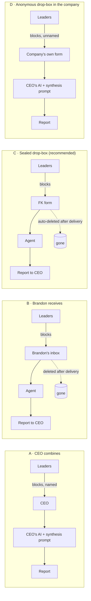

# Data-flow decision memo · Rotor Alignment Diagnostic

**Deliverable 1 of 8 · Draft for Brandon · 2026-11-09**
Written by Ines (Steward). Vera's guardrail checklist applied in the same session (no separate subagent run).
Nothing has been built, published, sent or bought.

---

## Gate packet

```
GATE 1 (data flow) · Rotor Alignment Diagnostic · 2026-11-09
Decision needed: where leaders' summary blocks go, and who can see them.
Recommendation: Option C, "sealed drop-box". Leaders submit their own
  block to a Franklin Kinetics form; an agent writes the report; no
  person reads the blocks; the blocks are deleted when the report is sent.
  Run the first one or two by hand (Option B) to learn, then automate.
Options: A) CEO combines  B) Brandon receives  C) Sealed drop-box
         D) Anonymous drop-box inside the company
Four Proofs check: Speed: zero Brandon time per sale (C) · Abundance: the
  team's own knowledge, already in their heads · Craft: AI interviewer in
  their own platform · Goodwill: the report is useful even with no Beta
Risks / Vera flags: C makes Franklin Kinetics hold employees' candid
  opinions briefly. Needs a privacy notice, client terms, deletion, and
  a lawyer and insurance check before the first paid sale.
Hours so far: Brandon 0h · crew sessions 1
Reply: pass · pass with changes · hold
```

---

## 1. The question in one line

When a leader finishes their interview, **where does their summary block go, and who can see it?**

Everything else in the product follows from that answer. The report is only worth buying if leaders say what they really think. A divergence report built on polite answers shows false agreement, which is worse than no report. It also weakens the Beta offer, because the Beta exists to settle disagreements the report found.

## 2. What stays the same in every option

- The interview itself runs in the company's own AI platform (Claude, ChatGPT, Copilot or Gemini). The full conversation stays there. Only the **summary block** moves.
- Each leader sees their own block before it goes anywhere, and can edit or withhold it.
- The report needs at least 3 blocks. All quotes in it are unattributed.

## 3. The four options at a glance



Think of it as where the ballot box sits. In A, the CEO opens each ballot with the voter's name on it. In B, an outside scrutineer counts the ballots. In C, a locked machine counts them and shreds them. In D, the box is in the CEO's office but the ballots are unsigned.

## 4. Comparison

| | **A · CEO combines** | **B · Brandon receives** | **C · Sealed drop-box** | **D · Anonymous drop-box in company** |
|---|---|---|---|---|
| **Leader candour** | Lowest. Leaders write knowing the boss reads their exact words, with their name on it. Expect hedging on exactly the topics that matter. | High. An outsider sees it, not the boss. Some leaders will still wonder what Brandon does with it. | Highest. No person reads it, and leaders can be told so plainly. | Middle. Unsigned, but with 3–8 leaders the CEO can often guess who wrote what from the content. |
| **Privacy** | Data never leaves the company. But "unattributed quotes" is nominal: the CEO holds the named originals. | Franklin Kinetics holds employees' candid opinions until delivery. Brandon is personally exposed to the content. | Franklin Kinetics holds the data briefly, in a system no one reads. Smallest human exposure of B/C. | Data never leaves the company. Anonymity is partial. |
| **CEO effort** | Highest: collect blocks, paste them in, run the prompt, check the result. About an hour. | Low: share a link, wait for the report. | Lowest: share a link, wait for the report. | High: set up an anonymous form, collect, paste, run the prompt. |
| **Brandon's time per sale** | About 0. Support questions only. | Crew estimate 30–60 min: receive, check count, run agent, check report, send, delete, log. Not zero. | About 0 once built. Exceptions only (e.g. a stuck submission). | About 0. Support questions only. |
| **3-leader minimum** | Honour system. The CEO can run the prompt on 2 blocks. | Enforced by Brandon. | Enforced by the system: no report until 3 blocks arrive. | Honour system. |
| **Protects the synthesis method** | No. The synthesis prompt sits in the client's AI, fully readable. | Yes. | Yes. | No. |
| **What it needs** | A synthesis prompt in the setup kit. Clear instructions to refuse under 3 blocks. | Secure inbox or upload; disclosure note; privacy notice; short client terms; deletion log; lawyer and insurance check. | Everything in B, plus a form, an automation link to the agent, auto-delete, and a failure alert. One-time build. | Setup-kit instructions for an anonymous form in Microsoft 365 or Google; synthesis prompt. |
| **Hosting** | None. | Brief (Brandon's email or storage). | Brief (form tool and automation, plus the AI provider that runs the agent). | None. |

## 5. Recommendation: Option C, sealed drop-box

**Why:**
1. **Candour is the product.** A divergence report is only as good as the disagreement it surfaces. A and D both leave the CEO holding something that lets them trace views back to people. In a 20–200 person, owner-led firm, leaders know that.
2. **It's the only option that meets both "zero Brandon time" and "more candour."** B gets candour but costs Brandon about an hour per sale and puts the content in his inbox.
3. **It enforces the rules instead of trusting them.** The 3-leader minimum and unattributed quotes happen by design, not by the CEO's good behaviour.
4. **It keeps the synthesis method on our side.** In A and D the full synthesis prompt ships to every buyer. That makes it easy to copy and harder to keep Rotor ideas out of view.

**How to start (smallest thing that proves the point):**
- Run the first one or two diagnostics as **B, by hand**: leaders submit to a form, Brandon or the crew runs the agent, checks the report, sends it, deletes the data. That's the dry run in deliverable 8.
- Once the report format holds up, automate the same path into **C**. Nothing is built or bought until you pass this gate and the spec gate.

**Keep D as a fallback** for a buyer whose policy says no employee data may leave the company. Same kit, different last step. Decide at the spec gate whether to offer it at all.

## 6. What C would require before the first paid sale

None of this is done. All of it needs your decision, and some of it needs spend.

| Need | Why | Who |
|---|---|---|
| **Disclosure note for leaders**, shown before the interview and again before submitting | Leaders must know where the block goes, that no person reads it, that it's deleted, and that unattributed quotes may appear in the report. Builds on the Pack's existing disclosure note. | Fenn drafts, Vera checks |
| **Privacy notice** on franklinkinetics.com covering the diagnostic | Required when collecting personal information. A leader's opinions, tied to their identity, are personal information. | Fenn drafts, lawyer reviews |
| **Short client terms** (the CEO's company is responsible for its employees' data; Franklin Kinetics processes it only to make the report, then deletes it) | Canadian privacy law (PIPEDA in Saskatchewan) treats the client company as accountable and Franklin Kinetics as its service provider. That needs to be written down. | Lawyer |
| **Cross-border note** | The form tool and the AI provider are likely US-based. Canadian guidance expects people to be told their data may be processed outside Canada. | Juno checks each provider's terms |
| **Data-retention check on the AI provider** | Confirm the provider's current terms on retention and training use for API data. Prefer the shortest retention available. | Juno |
| **Auto-delete and a deletion record** | "Deleted after delivery" must be true and provable. Keep a log that says *when* a set was deleted, never *what* it contained. | Mack |
| **Breach plan, one page** | PIPEDA requires reporting certain breaches. Know the steps before holding any data. | Vera drafts, lawyer reviews |
| **Insurance check** | Ask your broker whether you're covered for holding client employees' confidential opinions. The usual lines are professional liability (E&O) and cyber or privacy liability. | Brandon |
| **Quebec decision** | Quebec's privacy law is stricter, including on sending data outside the province. Simplest first step: not available to Quebec-based companies until checked. | Brandon decides |

This is the crew's reading of the rules, not legal advice. A one-hour review with a Canadian privacy lawyer before launch is the right size of check.

## 7. Vera's flags (in all options)

- **Admins can often see chats.** On company plans of Copilot, ChatGPT, Claude and Gemini, IT admins can often view or export conversation history. Leaders may hold back for that reason in any option. The setup kit should say so honestly and suggest the platform's private or temporary chat mode where one exists. Needs a check per platform (Juno).
- **Free and personal AI accounts** may use conversations for training unless the user opts out. The kit should tell leaders to use the company plan, or to turn that setting off.
- **Small teams make quotes recognisable.** With 3 leaders, even an unattributed saying can point to one person. The synthesis agent should drop names, roles and identifying details, and leaders should agree to possible quotation before they submit.
- **No names of other staff.** The interviewer should steer leaders away from naming individual employees. The agent should remove any that slip through (guardrail 10).
- **The interviewer instructions ship to every buyer** in every option. Deliverable 3 must contain no Rotor Core content (guardrail 12).
- **Beta price stays internal.** The CAD $6,000–10,000 range is for Sol's check in deliverable 6 only. It never appears in the report or on the site (guardrail 7).

## 8. Questions for you (batched)

1. **In the Beta today, who receives the leaders' summary blocks?** If it's you, Option C matches the Beta's flow and keeps the diagnostic and Beta data comparable.
2. **"Deleted after delivery" vs "comparable with Beta data."** If we delete everything, the comparison can only use the report the CEO keeps. Options: (i) delete everything; (ii) keep the report, with the client's consent, and nothing else. Which do you want?
3. **Does the summary block format include the leader's name or role?** I need the Pack to answer this. If it does, the drop-box should strip it on arrival.
4. **Do you carry professional liability or cyber insurance today?**
5. **Quebec:** exclude for now, or check first?

## 9. What happens next

At your answer, Ines logs the outcome in `logs/gates-log.md`. On a pass, the crew moves to deliverable 2 (product spec). No build starts until the spec gate passes.

---

## Gate outcome · 2026-11-09
**Pass. Option C.** Answers: (1) Beta blocks go to Brandon. (2) Keep the report, with consent; delete the blocks. (3) The block includes name and role. (4) No insurance today. (5) Exclude Quebec.
