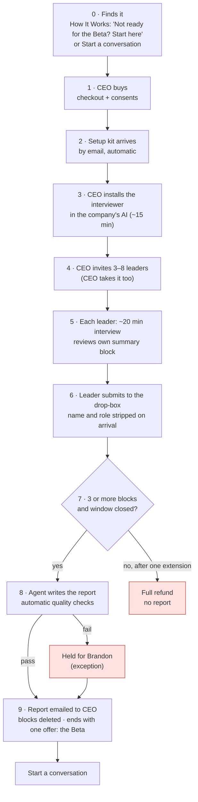

# Product spec · Rotor Alignment Diagnostic

**Deliverable 2 of 8 · Draft for Brandon · 2026-11-09**
Written by Ines (Steward). Builds on the passed data-flow memo (Option C, sealed drop-box).
Nothing has been built, published, sent or bought.

---

## Gate packet

```
GATE 2 (spec) · Rotor Alignment Diagnostic · 2026-11-09
Decision needed: is this the right buyer journey, and the right
  split between automated steps and your time?
Recommendation: approve the 9-step journey below. Normal path needs
  zero Brandon time. You touch only exceptions (a failed quality check,
  a refund, a support email). First 1–2 runs by hand, then automate.
Launch blockers (before the first paid sale): insurance, a privacy
  lawyer review, the privacy notice and client terms.
Four Proofs check: Speed: 0h per sale on the normal path · Abundance:
  the team's own knowledge · Craft: AI interviewer in their own
  platform, sealed synthesis · Goodwill: a useful report, Beta optional
Risks / Vera flags: insurance gap (no cover today); duplicate or
  fake submissions; small-team quotes can be traced (see section 6)
Hours so far: Brandon 0h · crew sessions 2
Reply: pass · pass with changes · hold
```

---

## 1. The journey at a glance



Pink boxes are the only places Brandon might touch a sale.

## 2. Step by step

| # | Step | What happens | Who does it | Automated? |
|---|---|---|---|---|
| 0 | **Finds it** | CEO lands on the diagnostic's own page from How It Works ("Not ready for the Beta? Start here") or from Start a conversation. | CEO | n.a. |
| 1 | **Buys** | Checkout collects: buyer name and email, company name, province of head office, platform (Claude, ChatGPT, Copilot or Gemini), planned number of leaders (3–8). Two consents: terms and privacy notice (required); "keep our report for Franklin Kinetics' research" (optional, **not pre-checked**). Quebec head office: checkout stops with a plain note. | CEO | Yes |
| 2 | **Setup kit** | Email with: one-page CEO guide; interviewer instructions and install steps for their platform; the company's private drop-box link; a leader invitation they can copy and send; the disclosure note; a status link. | System | Yes |
| 3 | **Installs** | CEO adds the interviewer to the company's AI platform (e.g. a Claude Project, a ChatGPT custom GPT, a Copilot agent, a Gemini Gem). Estimate ~15 min, to confirm at the dry run. | CEO | n.a. |
| 4 | **Invites** | CEO sends the invitation to 3–8 leaders, including themself. **Franklin Kinetics never emails leaders.** | CEO | n.a. |
| 5 | **Interview** | Each leader takes one ~20 min interview, by voice or text, on their own time. The interviewer uses wave 1 questions unchanged and ends with the fixed-format summary block. The leader reads it and can edit or remove anything. | Leader | n.a. |
| 6 | **Submits** | Leader pastes the block into the drop-box. They read the disclosure note and tick "I understand unattributed quotes may appear" (required). The drop-box checks the format, **strips name and role before storing**, and shows "Received." No leader email is collected. | Leader, then system | Yes |
| 7 | **Window** | The window is open 21 days from purchase. The CEO's status page shows **only a count** ("4 received"), never who or what. The CEO can close early once 3 are in. Under 3 at day 21: one automatic 14-day extension. Still under 3: automatic full refund, no report, blocks deleted. | System | Yes |
| 8 | **Report** | The synthesis agent (deliverable 4) writes the report. Automatic checks before sending: 3+ blocks; no names or roles; quotes unattributed; no recommendation of a main effort; no ROI or results language; every section present. A failed check holds the report for Brandon. | Agent | Yes |
| 9 | **Delivery and offer** | Report emailed to the CEO (PDF). Blocks and name fingerprints deleted at once; the deletion is logged (date and count only). The report is kept only if the CEO consented. The report ends with one offer: help settling the open questions, the Rotor Beta, via Start a conversation. | System | Yes |

## 3. What Brandon touches

**Normal path: nothing.**

| Exception | How often (guess, to check at dry run) | Brandon's time |
|---|---|---|
| Report fails a quality check | rare once the agent is tuned | ~15 min to read the report (not the blocks) and release or fix |
| Refund under 3 leaders | rare | none if the checkout refunds automatically; a few minutes if not |
| Support email ("the interviewer won't install") | some, early on | minutes; the answers become FAQ entries |
| First 1–2 runs by hand | once | a few hours across both, logged as Brandon's hours |
| A CEO books a Beta conversation | the point of the product | the conversation itself (that's the Beta, not this product) |

## 4. Data: what is kept, and for how long

| Data | Kept | Why |
|---|---|---|
| Full interview conversation | **Never leaves the company's AI platform** | We never see it |
| Summary block (name and role stripped) | Until the report is delivered, then deleted | Needed to write the report |
| Name fingerprint (a one-way code made from the name) | Same as above | Catches duplicate submissions without storing the name |
| Name and role in clear text | **Never stored** | Stripped on arrival |
| Report | Kept only with the CEO's consent; otherwise deleted at delivery | Comparison with Beta data (decision 2026-11-09) |
| Purchase record (CEO name, email, company, amount) | As long as tax rules require | Bookkeeping; confirm with accountant |
| Deletion log (date, count) | Kept | Proof that deletion happened |

## 5. What gets built (deliverables 3 and 4 plus a small system)

| Part | What it is | Notes |
|---|---|---|
| Diagnostic page | Own page on franklinkinetics.com | Copy is deliverable 7 |
| Checkout | Card payment with refund support | Sol picks at deliverable 6 |
| Setup kit | Four versions of the install guide, one per platform | Juno confirms each platform's current setup steps |
| Interviewer | Deliverable 3 | Ships to every buyer, so it contains no Rotor Core |
| Drop-box | Small web form + checks + temporary storage + count | Mack. Canadian hosting region preferred. A plain form tool can't strip names before storing, so this needs a little code |
| Synthesis agent | Deliverable 4, running on an AI provider's API | Stays on our side; buyers never see it |
| Quality checks | An automatic checklist run on every report | Mack and Vera |
| Emails | Setup kit, report delivery, refund notice | Sent to the CEO only |

**Phase 1 (dry run):** drop-box form plus the agent run by hand. Smallest thing that proves the report is worth reading.
**Phase 2:** automate steps 7–9 once the report holds up.

## 6. Risks and how the spec handles them

| Risk | Handling |
|---|---|
| **No insurance today** | Launch blocker. Get professional liability and cyber quotes before the first paid sale. Recommend before the dry run too, since it uses real data. Your call and your spend. |
| CEO pressures leaders to show their blocks | The kit tells the CEO plainly that the product works because they *don't* see blocks. The status page shows a count only, so the CEO can't tell who has submitted. |
| Duplicate or fake submissions | Name fingerprint catches the same name twice. The private link limits who can reach the drop-box. A determined insider could still game it; accepted for v1. |
| Small team makes quotes traceable | Leader must tick consent before submitting; the agent drops identifying details; the report never splits views by role. |
| Leaders' chats visible to company IT admins | Kit says so honestly and points to private or temporary chat modes where the platform has one. |
| Leader based in Quebec at a non-Quebec company | Kit asks the CEO to invite only leaders outside Quebec for now. |
| Report reads as advice on strategy | Quality check blocks any recommended main effort. The report shows gaps and ends with questions. |

## 7. Questions for you (batched)

1. **What is franklinkinetics.com built on** (Squarespace, Wix, WordPress, something else)? It decides how the page and checkout fit in.
2. **Window and refund:** 21 days, one 14-day extension, then a full automatic refund if under 3 leaders. OK?
3. **Insurance timing:** get cover before the dry run, or only before the first paid sale?
4. **Follow-up:** after the report, nothing more (the report carries the offer), or one plain check-in email at 14 days?
5. **Status page:** count only, as recommended? Or should the CEO also see the planned number ("4 of 6")?
