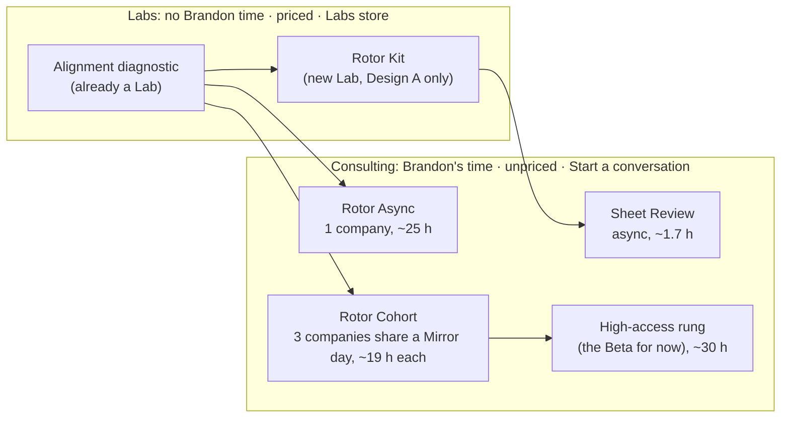
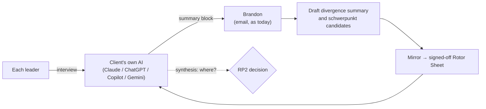

# Rotor Product · RP1 options memo

Ines, 2026-11-10. For Brandon's decision at Rotor Product Gate 1 (RP1). Inputs: the Beta Playbook, the Interviewer Pack, the website copy, the decisions log and Juno's [market scan](market-scan.md).

**The question:** which design do we spec at RP2?

**In short:** I recommend **Design D, the Ladder, staged**. The core is a **Cohort**: three companies start together and share one Mirror day. The alignment diagnostic is the entry rung. The current Beta stays alongside, unchanged, as the high-access rung until RP6. Reasoning is in section 6.

---

## 1. How to read the numbers

- **All minutes are my estimates.** They are Living Models, not data. The only baseline we have is the playbook's own estimate for the Beta: 20–25 h in the build plus 8–10 h across the live run and review, so **about 28–35 h per client**. Every design below gets replaced by tracked hours from its first clients.
- **The budget is 5 h/week, which is about 240 h a year** (48 working weeks). Selling also comes out of it: discovery calls, proposals, follow-ups. I reserve **about 1 h/week (≈40–50 h/yr) for selling and admin**, which leaves **about 4 h/week, or ≈190 h/yr, for delivery.**
- **Peaks matter more than averages.** The build phase is heavy and the live run is light, so each design shows its worst week as well as its average.
- **A "day off" means a planned workday taken off for client time during business hours.** Evening and weekend time comes out of the weekly hours instead.

### The Beta today, measured the same way (for comparison)
| | Beta (as designed) |
|---|---|
| Brandon per client (est.) | ~28–35 h over ~18 weeks |
| Build-phase load | ~4 h/week per client, so one client in build at a time |
| Capacity at 5 h/wk | ~5–6 clients/yr if starts are perfectly staggered; realistically 4 |
| Days off | ~2–3 per client (kickoff, Mirror, review are with leadership teams in business hours) → **8–12/yr** |

So the Beta as designed fits the budget only at low volume, and it uses days off one client at a time. That is the problem the designs below try to solve.

---

## 2. The four designs at a glance

| | **A. Shelf** | **B. Rotor Async** | **C. Rotor Cohort** | **D. Ladder (recommended)** |
|---|---|---|---|---|
| In one line | Clients run Rotor themselves; Brandon reviews their draft | The Beta, one company at a time, with AI doing more and Brandon doing less | Three companies go through together and share Brandon's live time | Diagnostic → Cohort → a small high-access rung |
| Brandon per client (est.) | ~1.7 h (Review only) | ~25 h | ~19 h | ~19 h cohort / ~30 h high-access |
| Clients/yr at 5 h (est.) | Kit: no limit · Reviews: ~2 a week | ~5–6 | ~9 (3 cohorts of 3) | ~8 (2 cohorts + 2 high-access) |
| Clients/yr at 10 h (ceiling) | Reviews: ~4 a week | ~10–12 | ~15–18 | ~14 |
| Days off/yr at 5 h (est.) | 0 | ~5–6 | ~6 | ~8–10 |
| Days off per client | 0 | 1 | 0.67 | 0.67 / 2 |
| Worst week | ~4 h (if Reviews bunch) | ~5 h (two clients in build) | ~4–5 h (cohort in build) | ~5 h |
| Who signs off the schwerpunkt | The client's leadership team alone, unless they buy a Review | Brandon with the leadership team, at the Mirror | Same, at each company's Mirror | Same |
| Relation to Beta (a possibility, not a decision) | Feeds it | Could replace it | Could replace it, or run alongside | Includes it (high-access rung) |

---

## 3. The designs in detail

### Design A · Shelf (mostly self-serve)

**The idea.** The diagnostic shows the gaps. A new **Rotor Kit** Lab lets a leadership team run the whole distillation themselves, in their own AI. An optional, unpriced **Sheet Review** gives them Brandon's eye on the result, asynchronously.

**What the client experiences**
| Week | Client | Brandon |
|---|---|---|
| 0 | Buys the diagnostic; leaders take the AI interview; agent produces divergence report | — |
| 1 | Buys the Kit; installs the interviewer and facilitator in their own AI | — |
| 1–3 | Leaders do waves 1–3 with the AI; AI drafts divergence summary and schwerpunkt candidates | — |
| 4 | CEO runs their own Mirror using a facilitation guide; team picks a schwerpunkt; five-tests checker on every line | — |
| 5 | Optional: sends the draft Rotor Sheet for a Sheet Review | Reads it, records a ~15-min video and written markup (~100 min) |
| 6+ | Loads the Sheet into their AI using a plain guide (no Rotor Core) | One follow-up reply |

**Labs or consulting**
- Labs: the diagnostic, the Kit, and the five-tests checker.
- Consulting: the Sheet Review.

**What AI does:** everything up to the draft, plus checking each line against the five tests.

**Brandon per Review client:** 30 min reading, 30 min markup, 25 min video, 15 min follow-up = **~100 min**.

**Capacity and days off:** about 2 Reviews a week at 5 h. Days off: 0.

**Where his presence matters most:** the Review video. It is the client's only contact with him.

**Data:** everything stays in the client's AI. Brandon receives only a draft Sheet they choose to send.

**Main risks**
- **The schwerpunkt is chosen without Brandon.** It is not automated, because the client's team signs it off, but the judgment clients pay Brandon for is absent unless they buy a Review. Weak sheets would carry the Rotor name.
- **The Kit hands out the method.** The playbook lists "the interview, facilitation and diagnostic process" among the things that stay with Brandon (Protecting the Core). The Kit would sell exactly that.
- **No Rotor Core.** Without it, the client's AI gets the Sheet but not the reasoning. That is a lesser product, so the Beta must remain the place where the Core is loaded.
- **The CEO facilitates their own Mirror.** That is the session the playbook calls the highest-value moment, and a CEO running it removes the outsider who makes honest convergence easier.

**What the first three clients teach us:** will owners run a distillation on their own? How good is a self-made sheet? Does a Review lead to a conversation?

### Design B · Rotor Async (the Beta, leaner, one company at a time)

**The idea.** Same arc as the Beta. Brandon's work is cut by letting AI draft more (flight logs, pulses, red-team runs, wave 2/3 files) and by fixing his touchpoints. **Live time is cut to one session: the Mirror.** Kickoff and review become a recorded video plus a short call at a time Brandon sets (early morning or evening).

**What the client experiences**
| Week | Client | Brandon (min) |
|---|---|---|
| 0 | Discovery conversation | 45 |
| 1 | Personal welcome video; 45-min kickoff call at a time Brandon sets; interviewer installed | 80 |
| 1–2 | Wave 1 AI interviews | reads transcripts, checks AI synthesis (part of 330 below) |
| 2–4 | Wave 2; divergence summary (AI drafts, Brandon edits) | 330 total for waves + 45 summary |
| 4–5 | Wave 3: reactions to schwerpunkt candidates **Brandon chose from AI drafts** | in the 330 |
| 6 | **The Mirror**, 2.5 h, live | 60 prep + 150 live (**1 day off**) |
| 6–7 | Sheet finalized and signed off; CEO video script (AI draft, Brandon edits); red-team run by AI, annotated by Brandon | 45 + 30 + 60 |
| 7–18 | Live run: weekly flight log (AI drafts, Brandon approves), monthly pulse, replies within the stated standard | 135 + 45 + 255 |
| 19 | Review: AI compiles results; 75-min review at a time Brandon sets | 60 + 90 |
| — | Contract, invoicing | 60 |

**Total ~1,490 min ≈ 25 h per client.**

**Labs or consulting:** the diagnostic as the entry (Lab). Everything after is consulting.

**What AI does:** interviews, first-pass synthesis, drafts of the waves, schwerpunkt candidates, script, flight logs, pulses, red-team runs, results pack.

**Capacity**
- At 5 h: ≈190 delivery h ÷ 25 ≈ 7 in theory. The build phase runs ~2.5 h/week per client, so at most two clients can be in build at once. **Realistically 5–6 a year.**
- At 10 h: 10–12 a year.

**Days off:** 1 per client, for the Mirror. That is **5–6 a year, each serving one client.**

**Where his presence matters most:** the Mirror and the schwerpunkt candidates.

**Data:** interviews run in the client's AI, as today.
- **Open question:** where does synthesis run? See section 5.

**Main risks**
- **It is the Beta with less of Brandon.** Clients may feel the difference.
- **Days off still scale one to one with clients.**
- **Moving kickoff and review out of business hours** depends on clients accepting early or late calls.

**What the first three clients teach us:** whether one live session is enough to feel heard, and how many minutes the transcript review really takes.

### Design C · Rotor Cohort (three companies share Brandon's live time)

**The idea.** Three companies, never more than three, start in the same week. Each company's strategy work stays separate and private. What they share is Brandon's live time: a group kickoff, **one Mirror day with three back-to-back Mirrors**, monthly group clinics and one review day. Between those, each company runs async with AI, exactly as in Design B.

**Why three is the cap:** three 2-hour Mirrors (8:30, 11:00, 14:00) fill one workday. A fourth company would need a second day. Mirrors are 2 h, not 2.5–3 h, because wave 3 already settles most lines and the Mirror spends its time on the contested calls.

**What the client experiences**
| Week | Client | Brandon (min per client; shared items ÷3) |
|---|---|---|
| 0 | Discovery conversation; joins the next cohort (the diagnostic is the waiting room) | 45 |
| 1 | Group kickoff, 90 min, evening, recorded. CEOs meet each other; the method is taught; nothing company-specific | 40 (120 shared) |
| 1–7 | Waves 1–3 run async per company. **The build is stretched from 6 to 8 weeks** so the peak fits 5 h | 240 transcripts and synthesis + 90 schwerpunkt candidates |
| 8 | **Mirror day:** each company gets its own private 2-hour Mirror | 45 prep + 120 live (**1 day off per cohort**) |
| 8–9 | Sheet sign-off, video script, red-team | 45 + 30 + 45 |
| 9–20 | Live run: flight log every two weeks (AI drafts), monthly pulse, replies; **monthly 60-min group clinic in the evening** | 72 + 45 + 120 + 60 (180 shared) |
| 21 | **Review day:** three private 75-min reviews | 120 (**1 day off per cohort**) |
| — | Contract, invoicing | 45 |

**Total ≈ 1,160 min ≈ 19.5 h per client, ≈ 58 h per cohort over ~21 weeks.**

**Labs or consulting:** the diagnostic as the entry and waiting room (Lab). Everything else is consulting.

**What AI does:** the same as Design B, plus drafting clinic agendas from the cohort's own questions.

**Capacity**
- At 5 h: average ~2.8 h/week per cohort, with a peak of ~4–5 h in Mirror-prep weeks. A new cohort starts once the last one enters its live run, so **3 cohorts a year = 9 clients, ~175 h.**
- At 10 h: 5–6 cohorts, 15–18 clients.

**Days off:** 2 per cohort. That is **6 a year for 9 clients**, about 0.67 per client, against 1–3 per client today.

**Where his presence matters most**
- The Mirror. It keeps its full value because it stays private.
- The schwerpunkt candidates.
- The clinics: the CEOs get Brandon and each other, a peer format that Vistage and EO sell (market scan §2; no verified evidence yet on what buyers pay for it).

**Data**
- Interviews run in each client's own AI.
- **Nothing crosses between companies.** Shared sessions teach the method only. CEOs may share their own stories in the clinic under an agreed "what's said here stays here" rule, and nothing is recorded except the kickoff.

**Main risks**
- **Filling a cohort.** Three companies have to be ready in the same window. A client who is ready now waits up to ~3 months; the diagnostic keeps them engaged meanwhile. If only two sign, run with two.
- **One slow company.** Each company runs in its own async lane; only the Mirror day and the review day are fixed.
- **Confidentiality between cohort companies.** Avoid putting direct competitors in the same cohort.
- **Peers may dilute the "Brandon works with you directly" promise.** The private Mirror protects it.

**What the first three clients teach us:** whether the Mirror day works three times over, whether clinics add value or are just obligation, real hours per client, and how hard cohorts are to fill.

### Design D · The Ladder (recommended, staged)

**The idea.** Three rungs. Each rung answers "how much of Brandon do you need?"

1. **Alignment diagnostic (Lab, priced, Labs store).** Already decided. It shows the gaps, and it is the waiting room for the next cohort.
2. **Rotor Cohort (consulting, unpriced).** Design C, as the main offer.
3. **High-access rung (consulting, unpriced, at most 2 a year).** For a client who needs Brandon in the room: a private kickoff, an in-person Mirror, a monthly live call, faster replies. **Until RP6 this rung is simply the current Rotor Beta**, unchanged. That keeps the Beta's name, terms and form untouched while giving us a side-by-side comparison.

**Capacity at 5 h/week**
| | Clients | Brandon h | Days off |
|---|---|---|---|
| 2 cohorts of 3 | 6 | ~116 | 4 |
| 2 high-access (the Beta) | 2 | ~60–70 | ~4–6 |
| Selling and admin | — | ~45 | — |
| **Total** | **8** | **~220–230 of 240** | **~8–10** |

At 10 h, add 2–3 more cohorts, for about 14 clients, without adding high-access clients.

**Labs or consulting:** the diagnostic is a Lab (and a possible small Lab later, below). The Cohort and the high-access rung are consulting.

**Where his presence matters most**
- Cohort clients: the Mirror, the schwerpunkt candidates and the clinics.
- High-access clients: Brandon's presence throughout, which is what they choose it for.

**Main risks**
- **Three offers are more to explain than one.**
- **The high-access rung's days off** are the most expensive line in the budget.
- **Running the Beta alongside the cohort** means two delivery rhythms at once.

**What the first three clients teach us**
- Run the first cohort of three as the test. That is the cohort's evidence.
- If a Beta client signs during the same period, we get a direct comparison.

---

## 4. Where Brandon's presence creates the most value (all designs)

The playbook already points to this, and the override log will test it.

| Touchpoint | Value of Brandon here | Make it |
|---|---|---|
| Choosing the schwerpunkt candidates and signing off the schwerpunkt | Highest: this is the judgment clients pay for | Always Brandon. AI drafts; he decides |
| The Mirror | Highest: honest convergence needs an outsider in the room | Live, private per company, days off shared across clients |
| Recorded video replies | High: being heard, in his voice | Async; a short reply per company at key moments |
| Reading every transcript | High for trust (promised in the disclosure note); medium for insight | Keep for now; the override log decides later |
| Group clinics | Medium–high: peer value plus access | Live, evening, shared |
| Flight logs, pulses, red-team runs | Low: AI does them well | AI drafts; Brandon approves in minutes |
| Kickoff and review logistics | Low | Group or recorded, at times Brandon sets |

---

## 5. Data flow (all designs)

- **Unchanged from the Beta:** interviews and transcripts stay in the client's AI; summary blocks reach Brandon by email; Brandon deletes his copies at the end.
- **Open question for RP2: where the AI synthesis runs.** Today's playbook doesn't say.
  - **(a)** In a second workspace in the client's own AI, with Brandon as a guest. Nothing is hosted, so this is the default I recommend.
  - **(b)** In Brandon's own AI account, deleted at the end. Easier, but it is holding client strategy data, so it needs Brandon's approval at a gate.
- **Cohort:** no client content crosses between companies.
- **The override log** holds only method notes ("AI drafted X, I changed to Y, because Z, at step W"). No company names, no quotes. It stays in Brandon's private library.
- **The Rotor Core** goes only into the clients' AI in the consulting designs, under licence. It is never in a Lab.

---

## 6. Recommendation

**Spec Design D at RP2, staged:**

1. **Now:** diagnostic (Lab, already decided) + **one cohort of three** as the first three clients. The Beta continues alongside, unchanged, as the high-access rung.
2. **After the first cohort's review:** the override log and tracked hours decide which steps move further to AI. They also decide whether a self-serve Kit (Design A) is safe to build later as a Lab.
3. **At RP6:** the evidence below settles whether the cohort replaces the Beta, or the Beta stays as the high-access rung.

**Why**
- **Days off are the scarcest thing Brandon has, and the cohort is the only design that shares them.** It needs ~6 days for 9 clients, against ~1 per client in Design B and 2–3 per client in the Beta. A cohort cannot grow past three, because three Mirrors fill one day, so the design caps itself.
- **It keeps Brandon where he matters.** He makes the schwerpunkt call for every client, and each client gets a private, live Mirror. AI takes the parts the playbook already rates as collecting rather than judging.
- **It fits 5 hours with room to spare** once the build is stretched to 8 weeks, and it scales to 10 without a redesign.
- **It adds something the Beta lacks:** a small peer group of owner-led CEOs, the format Vistage and EO sell (market scan §2).
- **It doesn't touch the Beta.** It sits alongside it and produces a fair comparison.

**Why not the others**
- **A** sells the method without the judgment, and the Kit exposes what the playbook says stays private. Keep it as a later Spark if the override log shows the steps are safe.
- **B** is safe but burns a day off per client.
- **C on its own** has no answer for the client who needs more of Brandon.

---

## 7. Relation to the Beta, and the evidence that would settle it (RP6)

This track does not retire, rename or reprice the Beta. "Could replace it" below describes what a design is able to do, as you asked; whether anything replaces the Beta is your call at RP6.

| Design | Relation to the Beta |
|---|---|
| A | Feeds it. Kit and Review buyers who stall are Beta candidates. It cannot replace it. |
| B | Could replace it: same arc, less time. |
| C | Could replace it, or run alongside it. |
| D | Contains it as the high-access rung for now. RP6 decides whether that rung stays the Beta or becomes something new. |

**Evidence to collect, without deciding now**
1. **Brandon's tracked hours** per client, by touchpoint, against these estimates. That includes days off actually used.
2. **Sheet quality:** the share of signed-off lines that pass the five tests first time, and leader agreement on the main effort before and after the Mirror. Both are already measures in the playbook.
3. **The override log:** how often Brandon changes AI drafts at each step, cohort against Beta.
4. **Client experience** in their own words: did they feel heard, did they get enough of Brandon, was the peer group worth it? Asked the same way of cohort and Beta clients.
5. **Live-run results:** noise audit and recall, cohort against Beta. Read with caution, because three clients are stories, not proof (playbook, "What a few betas can tell you").
6. **Filling:** how long it takes to fill a cohort, and how many diagnostic buyers become conversations.

---

## 8. Lab parts this would create (Sparks at RP2, not now)

- **The diagnostic** already exists as a decision but has no lab card yet. It must run in the client's own AI, or its data flow is decided at its own gate; Brandon reads none of its output, or it stops being a Lab. The cohort depends on it, so it should start the Lab lifecycle soon.
- **Possible new Spark:** a self-serve **five-tests checker**. It runs in the buyer's own AI: paste any strategy statement and it tests each line (decision, trade-off, new hire, hindsight, tripwire). Nothing is hosted or stored by Franklin Kinetics; any hosting would need Brandon's gate approval. Before it becomes a Lab, Brandon confirms the five tests are fine to publish (the playbook doesn't say). It needs none of Brandon's time and exposes no Core, and it is a strong Craft proof. It should get a G1 Four Proofs check like any Spark.
- **Rotor Kit (Design A):** parked until the override log says it is safe.

---

## 9. Questions only Brandon can answer (they change the RP2 spec)

1. **Days off:** roughly how many a year can you realistically take for clients? Design D needs about 8–10. With 6 or fewer, the high-access rung drops to one client a year.
2. **Mirror format:** remote or in person? Three in-person Mirrors in one day only work if the companies are in one city, such as Regina.
3. **Cohort companies meeting each other:** comfortable with that, with a rule against direct competitors in the same cohort?
4. **Kickoff and review out of business hours:** acceptable to ask clients for early-morning or evening slots?
