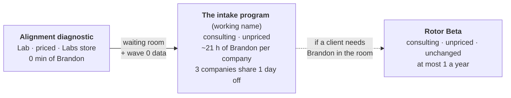
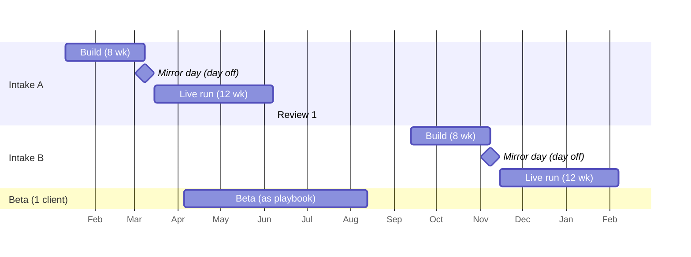
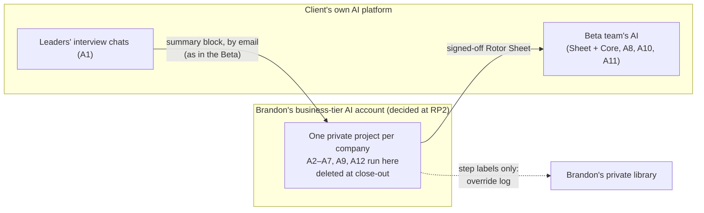

# Rotor Product · RP2 spec

Ines, 2026-11-10. For Brandon's decision at Rotor Product Gate 2 (RP2). This spec builds on the [RP1 options memo](rp1-options-memo.md), which passed on 2026-11-10 as Design D, the Ladder. It reuses the [Interviewer Pack](../interviewer-pack.md), the [Beta Playbook](../beta-playbook.md) and the alignment diagnostic.

**How to read the numbers:** every minute here is an estimate, a Living Model, and the first intake replaces them with tracked hours. Brandon's weekly budget means evenings and weekends. Days off are counted separately.

---

## 1. What we are building



| Part | Labs line: does it need Brandon's time? | Sold where | Gates |
|---|---|---|---|
| Alignment diagnostic | **No → Lab** | Labs store; linked from How It Works and Start a conversation | Lab G1–G8 |
| Five-tests checker | **No → Lab** (new Spark) | Labs store | Lab G1–G8 |
| The intake program | **Yes → consulting** | Start a conversation | This track (RP3–RP6) |
| Rotor Beta | **Yes → consulting** | Start a conversation | Unchanged |

**New terms, for Brandon's approval** (to be added to the ontology if approved):
- **Intake:** up to three companies that start the program within the same three weeks and share one Mirror day. Companies in an intake never meet and never learn each other's names. To a client it is simply "the next start date".
- **Mirror day:** the one day off on which an intake's private Mirrors run.
- **Wave 0:** a diagnostic graduate's diagnostic data, used as the program's starting point.
- **Waiting room:** the diagnostic's role for a company waiting for the next intake.
- **Override log:** already in the playbook and decisions log; listed here so it enters the ontology.
- "Cohort" implied a group that meets, and "wave" is already used for interview waves.

**Product name:** a working name only. Fenn proposes the real one at RP4. Until then this spec says "the program".

---

## 2. The year at a glance

Two intakes and one Beta client. Every start date, Mirror day and review is booked a full term ahead, so time off work can be requested early.



*Dates are illustrative. Brandon picks the real windows.*

| | Intake A | Intake B | Beta client | Year |
|---|---|---|---|---|
| Companies | 3 | 3 | 1 | **7** |
| Brandon, evenings/weekends (est.) | ~58 h | ~58 h | ~25 h | ~141 h |
| Brandon, on days off (est.) | ~6 h (Mirror day) | ~6 h | ~5 h | ~17 h |
| Selling and admin (conversations that don't convert, practice admin; not T1/T14) | | | | ~45 h |
| **Total** | | | | **~186 h of 240 in evenings, plus ~17 h on days off** |
| Days off | 1 | 1 | ~2 | **~4 (max 5–6)** |
| 4 pm one-on-ones | 6 | 6 | 1–2 (kickoff; the review may need a day off) | **~13–14** |

*Variance from RP1:* RP1 estimated ~190 h a year in total. This spec puts it at ~203 h, because it counts replies and flight logs at a realistic rate. That is still inside the budget with margin.

**Calendar rules**
1. **Never two Mirror days within three weeks of each other**, including the Beta's Mirror. This is the playbook rule, tightened.
2. **Each intake's build overlaps no other build.** The Beta starts after Intake A's Mirror day, when Intake A is in its light live run.
3. **The Mirror day is fixed at signing**, and every company in the intake signs knowing the date. Brandon requests leave once the intake's first company signs.
4. **If only two companies sign, the intake runs with two.** If one, the company is offered the next intake or the Beta. No intake runs with one company.
5. **No direct competitors in the same intake**, even though they never meet. Brandon is holding two rivals' strategies in the same week, and that is a conflict he should avoid.

---

## 3. The client journey, week by week

Each company runs in its own lane. The three start one week apart (see the weekly load below); only the Mirror day and the review window are shared. Week numbers are for the first company.

| Week | The client does | AI does (agent) | Brandon does (min per company) | When |
|---|---|---|---|---|
| −4 to 0 | Discovery conversation; signs; the Mirror date is fixed. Diagnostic graduates bring their diagnostic data (section 7) | — | Discovery call and notes **45** · contract **20** | 4 pm or evening |
| 0 | Receives the welcome pack: the recorded kickoff video, the IT checklist, the disclosure note, the governance one-pager. IT installs the interviewer (A1) | Install check: a test session confirms the summary block comes out right | Personal 3-min welcome video **10** · install check **15** | Async |
| 1 | **CEO kickoff one-on-one**: scope, measures, exclusions, beta and comparison teams, reply standard | — | Prep **15** · call **45** | **4 pm, live** |
| 1–3 | Leaders do wave 1 interviews (wave 1 is shortened for diagnostic graduates). Kickoff measures: noise audit baseline and a time sample | A1 interviews · A10 noise audit · **A2 synthesis** after each block | Read transcripts (~5 leaders × 10) **50** · check synthesis, log overrides **20** | Evenings |
| 3 | — | **A3** drafts wave 2 follow-ups per leader | Approve or edit the wave 2 file **30** | Evening |
| 3–5 | Wave 2 interviews | A1 · A2 · **A4** drafts the divergence summary and language harvest | Read transcripts **50** · edit divergence summary **45** | Evenings |
| 5 | — | **A5** drafts 3–5 schwerpunkt candidates plus guardrails, living models and tripwires, *as options, with no recommendation* · **A6** runs the five tests on every line | **Choose and rewrite the candidates for wave 3** (the judgment the client pays for) **90** · wave 3 file **15** | Weekend |
| 5–6 | Leaders react to the draft in wave 3. CEO receives the divergence summary | A1 · A2 | Read transcripts **40** | Evenings |
| 7 | Leadership team receives the pre-read: the divergence summary and what the Mirror must settle | A2 drafts the contested-items list | Mirror prep: running order, contested calls, metaphor shortlist **45** · 3-min pre-Mirror video **15** | Evening |
| **8** | **The Mirror**: 2 h, the whole leadership team. Remote by default. In person only at each company's own office, with Brandon travelling between them, so no shared venue and no overlap. In person only if the travel fits between three 2-hour sessions (e.g. 8:00, 11:00, 14:30) | — | **120 live** | **Day off, shared by 3 companies** |
| 8–9 | Signs off the Rotor Sheet. CEO records the strategy video from the script. Team lead writes 10 dilemmas | A6 checks the final sheet · **A7** drafts the video script · the Sheet and the Rotor Core are loaded into the team's AI · **A8** runs the red-team dilemmas | Finalize the sheet **45** · edit the script **30** · annotate red-team results and tune **45** | Evenings |
| 1–9 | — | **A9** drafts the weekly flight log | Approve flight logs, 8 × **8** = **64** · replies, 8 × **10** = **80** | Evenings |
| 9–20 | Live run: the team works with the AI. Monthly pulse. Flight log every two weeks | A9 · **A11** pulse · A10 end-of-quarter noise audit | Flight logs 6 × **8** = **48** · pulse syntheses 3 × **15** = **45** · replies 12 × **10** = **120** | Evenings |
| 21 | Leadership team watches Brandon's results video. **CEO review one-on-one**: scale, adjust or stop | **A12** compiles the results pack (beta vs comparison team) | Check results pack **30** · results video **30** · CEO call **60** | **4 pm, live** |
| — | Invoice, close-out, deletion confirmation | — | **25** | — |

**Brandon per company:**
- About **1,292 minutes, or 21.5 h.** Of that, **120 min** is on the shared day off; the rest falls in evenings, weekends and two 4 pm calls.
- That is above the RP1 estimate of ~19 h. The spec counts replies and flight logs that RP1 understated.

**Live time per company:**
- Kickoff one-on-one, 45 min.
- The Mirror, 2 h.
- Review one-on-one, 60 min.

That totals about 3.75 h, against 4.5–6 h in the Beta.

**Weekly load for an intake of three** (evenings and weekends, excluding the Mirror day itself):

**Staggered starts (fixes a Vera catch).** Choosing candidates (T6) for all three companies in the same week comes to 5.25 h on its own, which breaks the cap. So the three companies start **one week apart** (weeks 0, 1 and 2) and share only the Mirror day. Their builds run 8, 7 and 6 weeks; the playbook's build is 5–6 weeks, so even the shortest is enough. Each company's heavy weeks then land in different weeks.

| Weeks | Load | Notes |
|---|---|---|
| 0–2 | ~2–2.5 h | One welcome and kickoff per week |
| 1–4 | ~3–3.5 h | Transcripts and synthesis, overlapping lanes |
| 4–6 | ~3.5–4 h | One company's T6 (1.75 h) per week, plus the others' transcripts |
| **7** | **~4.5–5 h** | Mirror prep for all three. This is the peak. Protect it: no other client work that week. |
| 8–9 | ~3.5 h | Sheets, scripts, red-team |
| 9–20 | ~1.3 h | Live run |
| 21–22 | ~3 h a week | Reviews, staggered over two weeks |

These are estimates. The hard cap in section 4 applies to the real numbers.

---

## 4. Brandon's touchpoints and time budgets

| # | Touchpoint | Mode | Budget per company | Why it's Brandon's |
|---|---|---|---|---|
| T1 | Discovery conversation | Live, 4 pm or evening | 45 | Trust; fit |
| T2 | Welcome video and install check | Async | 25 | Being heard begins here |
| T3 | CEO kickoff | **Live 4 pm, one-on-one** | 60 | Scope and governance are commitments |
| T4 | Transcript reading | Async | 140 | Promised in the disclosure note; the source of judgment |
| T5 | Synthesis, wave 2 file and divergence summary edits | Async | 95 | Quality of the mirror |
| **T6** | **Choosing the schwerpunkt candidates** | Async | **105** | **The judgment clients pay for. Never automated.** |
| T7 | Mirror prep and pre-Mirror video | Async | 60 | |
| **T8** | **The Mirror** | **Live, day off** | **120** | **Convergence needs an outsider in the room. Sign-off happens here.** |
| T9 | Sheet, script and red-team | Async | 120 | |
| T10 | Flight logs | Async (approve AI drafts) | 112 | Visible momentum |
| T11 | Replies within the standard | Async | 200 | Responsiveness, not availability |
| T12 | Pulse syntheses | Async | 45 | |
| T13 | Results video and CEO review | Async + **live 4 pm** | 120 | The decision to scale is the CEO's, with Brandon |
| T14 | Admin | — | 45 | |

**Hard caps** (Ines flags any breach in the friction log):
- **Over budget:** if any touchpoint runs over by more than 50% for two companies, it is re-specced before the next intake.
- **Week over 6 h:** if any single evening-and-weekend week passes 6 h, the next intake is cut to two companies.

**Reply standard:**
- A reply within **three working days**. This is longer than the Beta's two, because evenings only.
- Short video replies are allowed. Questions that are urgent for the client are flagged by them, and Brandon answers those first.

---

## 5. Every automated step (the agents)

Every agent is a plain-text instruction pack in the style of the Interviewer Pack: platform-neutral, with a fixed output format. No agent makes a decision. Each one drafts, and a person decides.

| Agent | What it does | Input → output | Runs in | Checked by | Override-log step |
|---|---|---|---|---|---|
| **A1** Interviewer | Leader interviews, waves 1–3 | Wave file → summary block | Client's AI (existing) | Brandon reads every transcript | S1 |
| **A2** Synthesizer | After each wave: themes, agreements, differences, unattributed quotes, language harvest, contested items | Summary blocks → wave synthesis | Brandon's account (section 8) | Brandon | S2 |
| **A3** Wave drafter | Per-leader wave 2 follow-ups; the wave 3 file | Synthesis → wave file | Brandon's account (section 8) | Brandon | S3 |
| **A4** Divergence drafter | Two-page divergence summary and language harvest, nobody quoted by name | Syntheses → draft summary | Brandon's account (section 8) | Brandon | S4 |
| **A5** Candidate drafter | 3–5 schwerpunkt candidates; guardrail, living-model and tripwire drafts. **Always options, with the trade-off of each. Never a recommendation, never one answer.** | Divergence summary → draft options | Brandon's account (section 8) | **Brandon chooses; the leadership team signs off at the Mirror** | S5 (logged for learning only; never handed to AI) |
| **A6** Five-tests checker | Runs each line through decision, trade-off, new hire, hindsight and tripwire; flags failures with a reason | Draft or final sheet → marked-up sheet | Brandon's account (same core as the five-tests checker Spark) | Brandon | S6 |
| **A7** Script drafter | 2–3 min CEO video script plus guardrail clips, in the language map | Sheet → script | Brandon's account (section 8) | Brandon, then the CEO | S7 |
| **A8** Red-team runner | Puts the lead's dilemmas to the loaded AI; records ambient, nudge or explicit; drafts annotations | Dilemmas → annotated table | Client's AI | Brandon, then the lead rates | S8 |
| **A9** Flight log drafter | Under 300 words: heard, taking shape, next, one question | Week's activity → draft log | Brandon's account (section 8) | Brandon approves | S9 |
| **A10** Noise audit | Existing variant | Cases → audit blocks | Client's AI (existing) | — | — |
| **A11** Pulse | Three questions monthly to the beta team; synthesis by team only | Answers → pulse synthesis | Client's AI | Brandon | S10 |
| **A12** Results compiler | Measures, beta vs comparison team, null results reported honestly, no financial claims | All measures → results pack | Brandon's account (section 8) | Brandon | S11 |

**Not automated, by design:**
- Choosing the schwerpunkt candidates (T6).
- The Mirror (T8).
- The CEO review (T13).
- Brandon's replies. AI may draft a reply, but Brandon sends it in his own words.

---

## 6. The override log

It applies Rotor's own rule to Brandon: repeated overrides are information.

**What gets logged:** every time Brandon changes an AI draft, one line.

```
date | intake-company code (e.g. 27A-2) | step (S1–S11) | change: none · cut · added · reworded · reordered · replaced
     | why: wrong · weak · tone · missing context · judgment call | minutes spent | method note (optional, about the agent's instructions, never about the client)
```

**Rules**
- **Private:** it lives in Brandon's private library, never in anything a client sees, and never in this repo.
- **No client content:** step labels and categories only. No paraphrase of a draft, no company names, no quotes. It holds no client strategy data, so it stays within the hosting rule. If Brandon needs the actual draft to remember a lesson, it stays in the client's Rotor workspace.
- **No-change steps count too.** A tally per step ("S9: approved unchanged ×4") gives the override *rate*, not just the overrides.
- **A step becomes a candidate to hand further to AI** when it has 15+ observations across 3+ companies, an override rate under 15%, and no "wrong" in its last 10.
- **Handing a step over is decided at a track gate**, never silently.
- **S5 (schwerpunkt candidates) is never handed over**, whatever the numbers say. The Mirror and the CEO review are not logged steps; they stay Brandon's.
- **Reviewed at each intake's end:** Ines produces the override-rate table, and Brandon decides. The same review compares the actual minutes against section 4.

---

## 7. Reuse: the Interviewer Pack and the diagnostic

### Interviewer Pack
- **Core instructions: unchanged.** The program uses the same interviewer, the same summary block and the same disclosure note, with brackets filled per company.
- **Wave files: unchanged in shape.** Waves 2 and 3 are drafted by A3 instead of by hand.
- **Noise audit variant: unchanged.**
- **Additions, to be built at RP3:**
  - a short wave 1 for diagnostic graduates;
  - a disclosure-note line naming the program;
  - the A2–A12 agent packs, kept *beside* the Interviewer Pack, not inside it, so the interviewer never sees synthesis instructions.
- **The Claude Doc master needs updating** once RP3 is built (per `rotor/README.md`).

### The diagnostic
- **Same questions:** the diagnostic asks the wave 1 questions (playbook), so its data maps straight onto the program.
- **Diagnostic graduates:**
  - with the client's consent, their diagnostic divergence report becomes **wave 0**;
  - wave 1 then drops the essentials already answered and asks only the gaps (shorter interviews);
  - leader agreement at the diagnostic becomes the "before" baseline.
- **The waiting room:** a company that signs for an intake months away takes the diagnostic first. That gives Brandon a head start and keeps the client engaged.
- **No dependence on Brandon's time:** the diagnostic stays a Lab. Brandon reads nothing from it unless the client becomes a program client and sends it.
- **Data flow** is the diagnostic's own Lab G2 decision. **Recommendation for that gate:** the diagnostic combines summaries *in the client's own AI*.
  - That means no hosting. The cost is that whoever runs it, the CEO or a convener the client names, sees individual answers.
  - The disclosure note says so up front.
  - No report for fewer than three leaders, and quotes unattributed. These are already rules.

---

## 8. Data flow: where the synthesis runs

> **Decided at RP2 (2026-11-10): option (b).** The AI drafting runs in Brandon's own business-tier AI account. The rules:
> - one private project per company, named by company code;
> - an account tier whose terms exclude training on its content (Juno confirms at RP3);
> - summary blocks reach Brandon as in the Beta;
> - everything is deleted at close-out, with a written deletion confirmation to the client.
>
> No client seat is needed. The text below records the options as they were weighed.

**Recommendation: (a) the client gives Brandon a seat in its own AI.** Brandon's own accounts hold no client strategy data.



**How (a) works**
- **The seat:** at signing, the client creates a member account for Brandon on its AI platform (for example on its own email domain) for the length of the engagement. The client pays for that seat, and the contract says so.
- **The private project:** Brandon sets up a "Rotor workspace" project shared with his account only. The A2–A9 and A12 packs run there.
- **Summary blocks:** leaders send their blocks and chat exports to Brandon's client-side account, not to his Franklin Kinetics email. That is a change from the Beta, where they go by email to Brandon.
- **Close-out:** the client removes the seat, and Brandon confirms in writing that he holds no copies.

**What Juno found** (low–medium confidence, from search snippets only; the official help pages were unreachable from this session):

| Platform | Outside-domain guest? | Practical route |
|---|---|---|
| Claude | Apparently not | A member account on the client's domain, one paid seat |
| ChatGPT | Unclear | A member account, one paid seat |
| Copilot | Disputed | A member account in the client's tenant |
| Gemini | Admin can allow a trusted domain (off by default) | Admin allowlist, or a member account |

A member account works everywhere in principle. Juno re-verifies against official docs at RP3 before anything is promised to a client, including each platform's no-training terms.

**The fallback, (b):** Brandon's own business-tier AI account, one project per company, deleted at close-out. This holds client strategy data, even briefly, so **it needs Brandon's approval**. My recommendation is **not to approve it now**. A client seat becomes a condition of the program, and we revisit (b) only if it costs a sale.

**Trade-off of (a):** the agent packs sit in the client's tenant, where an admin could read them. That exposes method, not the library. It is protected the same way as the Core: licence, confidentiality and a per-client fingerprint (playbook, Protecting the Core).

---

## 9. The Beta, alongside

- **The Beta runs exactly as the playbook says:** same name, terms, three live sessions and deliverables. This track does not change it.
- **At most one Beta client a year**, scheduled so its Mirror is three or more weeks from any intake Mirror day.
- **Whether the Beta uses the new agents (A2–A12)** to save Brandon's time is a delivery choice, not a product change. Brandon decides. It would also change how data reaches him (email in the playbook, a client seat in section 8). Using them would also make the RP6 comparison cleaner, because the only difference would be live access.

---

## 10. Risks and mitigations

| Risk | Mitigation |
|---|---|
| An intake doesn't fill | Run with two. The diagnostic is the waiting room. Never run one company as an intake. |
| One company stalls (interviews late) | Own lane. The Mirror date is fixed at signing, so a company not ready by week 6 moves to the next intake's Mirror day (stated in the contract). |
| The week-7 peak goes past 6 h | Hard cap rule (section 4). Next intake drops to two. |
| A day off is refused or cancelled | Request leave once the first company signs. The Mirror day has a fallback of evening Mirrors (5:30–7:30 pm, one company per evening, remote) the following week, agreed with clients at signing. |
| Clients feel they got too little of Brandon | Ask the same way at the review (RP6 evidence). Personal videos at T2, T7 and T13. |
| A5 candidates start steering Brandon's judgment (automation bias) | A5 must give 3–5 options, never a ranking. Brandon writes his own one-line view *before* opening A5's draft for the first two intakes. The note stays in the client's Rotor workspace. The override log records only whether his view matched A5's options (yes / partly / no), never the text. |
| Process exposure: agent packs installed in client AI can be read | Licence and confidentiality as with the Core; a fingerprint per client (playbook). Packs hold method, not the library. |
| Rotor Core exposure | Unchanged from the Beta: loaded only into the client's AI, under licence. Never in a Lab. |

---

## 11. Sparks added (Lab parts)

Added to `labs/sparks.md`, awaiting Lab G1:
1. **Alignment diagnostic.** Already decided as a Lab (2026-11-10) but missing from the queue; added so it gets a lab card and a Brief. The program depends on it.
2. **Five-tests checker.** Self-serve: paste a strategy and it tests each line. It runs in the buyer's own AI, with nothing hosted. Before it can be a Lab, Brandon confirms the five tests are fine to publish.

---

## 12. What RP3 builds

**Mack builds:**
- the agent packs A2–A9, A11 and A12;
- the short diagnostic-graduate wave 1;
- the welcome pack: kickoff video script, IT checklist, governance one-pager;
- the override log template;
- the intake calendar template.

**Fenn writes:**
- the async touchpoint templates: video scripts for T2, T7 and T13;
- the flight log house style;
- the reply guide.

**Ines writes:**
- the review checklists for T4, T5, T6 and T9;
- the dry-run plan for a friendly company.
