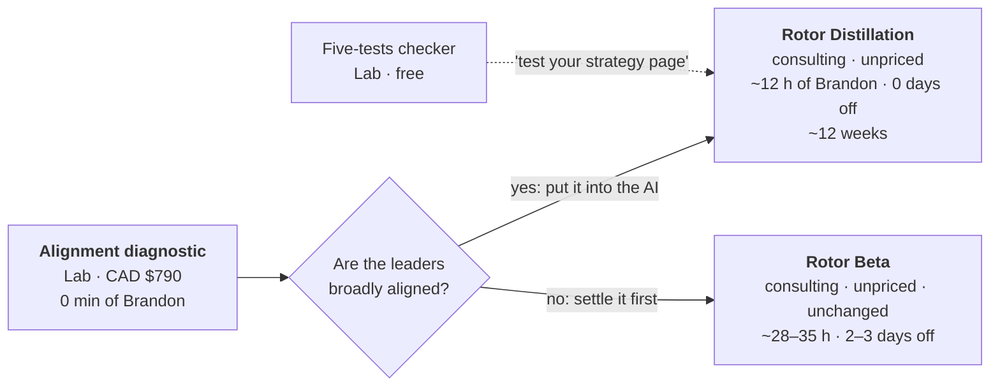

# Rotor Product · RP2 re-run: the Rotor Distillation, reshaped

Ines, 2026-11-11. This replaces the Distillation design in [rp2-spec.md](rp2-spec.md), which stays for the record.

**Why:** Brandon judged the Distillation and the Beta too similar (2026-11-11). The reshape splits them by the problem each one solves:
- **Rotor Beta:** "my leaders don't agree, and it shows." It covers alignment, people and AI. It is unchanged.
- **Rotor Distillation:** "we agree on our strategy, but our AI tools have never seen it." It covers the AI side.

**How to read the numbers:** all minutes are Ines's estimates (Living Models). The first clients replace them.

---

## 1. The ladder, sorted by the client's own data

| Part | Labs line | Sold where |
|---|---|---|
| Alignment diagnostic | Lab (no Brandon time) | Labs store, CAD $790 |
| Five-tests checker | Lab (no Brandon time) | Labs store, free |
| Rotor Distillation | Consulting | Start a conversation, unpriced |
| Rotor Beta | Consulting | Start a conversation, unpriced, unchanged |

**A fit check comes first.** A company that hasn't taken the diagnostic does a short fit check (step 0 below) before signing. If the leaders' main efforts clearly differ, Brandon recommends the Beta, or the diagnostic first. Brandon makes that call. It is never automated.

---

## 2. The client journey, week by week

Starts are rolling, with no intakes and no shared days. At most two companies are in weeks 1–4 at the same time.

| Week | Client does | AI does | Brandon does (min) | When |
|---|---|---|---|---|
| −2 to 0 | Discovery conversation. **Fit check:** the diagnostic report if they have one; otherwise the CEO and 1–2 leaders each do one 20-min AI interview (main-effort essentials) | A1 with a short "fit" wave file · A2 combines the blocks | Discovery **45** · read the fit summaries and decide Distillation or Beta **20** | 4 pm or evening |
| 0 | Signs. Receives the welcome pack and disclosure note. **Pastes its existing strategy material** (plan, EOS/OKR pages, offsite notes, values, sayings) into **A13 in its own AI** and emails Brandon the extraction | **A13 Document distiller** (new) | Read the extraction **20** | Async |
| 1 | **CEO kickoff:** scope, exclusions, which team and which AI tools, a beta team of 5+, measures | — | Prep **15** · call **45** | **4 pm or evening** |
| 1–2 | CEO does one 20-min AI interview; 1–2 more leaders optional | A1 · A2 | Read summaries **20** | Evenings |
| 2–3 | — | **A5** drafts the Rotor Sheet from *their* strategy: 2–3 sharper phrasings of the main effort they already chose, guardrails, living models with tripwires, language map. Gaps and contradictions are flagged, never filled in. **A6** runs the five tests | **Judge and rewrite the sheet** (the judgment clients pay for) **120** | Weekend |
| 3 | Leaders get the draft and send short written reactions via A1 (wave 3 file) | A1 · A2 | Read reactions **20** | Async |
| 4 | **CEO sign-off session:** open items settled; the CEO signs off the main effort and the sheet | — | Prep **20** · call **60** | **4 pm or evening** |
| 4–5 | IT loads the Sheet and the Rotor Core into the team's AI tools using the guide. The behaviour summary and employee note are published internally | Templates | Check the setup, finalize the notes **45** | Async |
| 5 | Team lead writes 10 dilemmas | **A8** red-team run | Annotate and tune **60** | Evenings |
| 5–11 | **Live use, 6 weeks.** One pulse. An update every two weeks. Replies within three working days | A9 · A11 | Updates 3 × 8 = **24** · pulse **30** · replies 6 × 10 = **60** | Evenings |
| 12 | Results pack. **CEO review:** keep, extend to more teams, set up a quarterly sheet review, or move to the Beta if splits showed up | **A12** (adapted: no comparison team) | Prep **30** · call **60** | **4 pm or evening** |
| — | Contract, close-out, deletion confirmation | — | **45** | — |

**Brandon per company: about 740 minutes, or 12.3 h.**
- **Live:** three calls (kickoff, sign-off, review), about 2.75 h, all at 4 pm or in the evening. **Days off: 0.**
- **Peak:** the week-2–3 sheet work is about 2 h per company, so two companies at once is a comfortable maximum.

**What the Distillation does not include:**
- leader-by-leader interview rounds;
- the Mirror;
- the one-page visual and the CEO video;
- the comparison team and the noise audit.

Those are the Beta's, and they make it the Beta.

**Measures** (no ROI, no financial claims):
- guidance quality, from the red-team ratings plus one in-use rating;
- recall of the main effort and two guardrails (pulse);
- a decision log of moments where the guidance changed a call;
- overrides and tripwires surfaced.

---

## 3. Brandon's year

| Plan at 5 h/week | Clients | Brandon h (est.) | Days off | 4 pm / evening calls |
|---|---|---|---|---|
| 8 Distillations | 8 | ~100 | 0 | 24 |
| Beta clients | 1–2 | ~30–70 | 2–3 each, so **3–6** | — |
| Selling and admin | — | ~45 | — | — |
| **Total** | **9–10** | **~175–215 of 240** | **3–6 (max 5–6)** | ~2 a month |

**With days off freed, the Beta could go to two a year.** That stays inside the 5–6 days off. Brandon decides. Client copy never states the number.

**4 pm calls:** about two a month. Evenings are offered first, since 4 pm isn't easy for Brandon.

---

## 4. The AI helpers: what's reused, changed, new or retired

| Helper | In the Distillation |
|---|---|
| A1 Interviewer | **Reused.** New short wave files: "fit" (main-effort essentials) and "CEO" (wave 1 essentials). The wave 3 reaction file is reused. |
| A2 Synthesizer | **Reused**, on fewer blocks |
| A3 Wave drafter, A4 Divergence drafter | **Not used** (Beta-style rounds) |
| A5 Candidate drafter | **Changed:** its input is A13's extraction plus the summaries. It sharpens the main effort they already chose (2–3 phrasings), and never invents a new one or picks between them. |
| A6 Five-tests checker | **Reused** |
| A7 Script drafter | **Not used** (no CEO video) |
| A8 Red-team | **Reused** |
| A9 Updates | **Reused**, every two weeks |
| A10 Noise audit | **Not used** (needs a comparison team and a quarter) |
| A11 Pulse | **Reused**, once |
| A12 Results compiler | **Changed:** before/after within the team; no comparison-team claims |
| **A13 Document distiller** | **New.** It runs **in the client's own AI**. It reads their strategy material and extracts stated priorities, trade-offs, beliefs, measures and recurring language, and flags gaps and contradictions. Output is a fixed-format block the CEO emails to Brandon. Override-log step S12. |

- **Override log:** unchanged rules, plus step S12 for A13. S5 (the main effort) is never handed to AI.
- **Simulation kit:** reusable. Mack adds a fictional strategy document and a "fit" run.
- **Client pack:**
  - welcome email, kickoff agenda, governance one-pager and disclosure note get rewritten, shorter;
  - the intake calendar is retired.

---

## 5. Data

Same principle as the RP5 decision B: Brandon receives distilled blocks, not raw material.

- **Stays in the client's own AI:** interviews and A13's reading of their strategy documents.
- **Emailed to Brandon:** the summary blocks and A13's extraction block. **He does not receive their strategy documents** unless the CEO chooses to send a specific one.
- **Drafting:** in Brandon's own AI account, one project per company, training switched off; deleted at close-out with written confirmation, and vendor retention stated.
- **The Sheet and the Rotor Core** go into the client's AI under licence, as in the Beta.

---

## 6. What this does to work already passed

| Gate | Effect |
|---|---|
| RP1 (Design D) | The ladder stands. The "private intake" engine is replaced by rolling starts. The Beta stays the high-access rung. |
| RP2 spec | Replaced by this file for the Distillation. |
| RP2 terms | *Intake*, *Mirror day* and *waiting room* are no longer used. Proposed: retire them from the ontology. *Wave 0* and *override log* stay. |
| RP3 build | About half reused (above). Mack builds A13 and the new wave files, adapts A5 and A12, and rewrites the client pack. Fenn rewrites the kickoff, welcome and results scripts. |
| RP4 package | The name stays. Fenn rewrites the ladder, the offer sheet and the founding wording. Diagnostic prices are unchanged. |
| RP5 story | Fenn redoes the website and playbook change lists against this design. |

---

## 7. Main risks

| Risk | Guard |
|---|---|
| Leaders don't really agree, so the AI carries a strategy nobody shares | The fit check before signing. Brandon declines, and suggests the Beta, if the main efforts differ or the plan can't pass the five tests without a real argument. |
| "Sharpening" turns into choosing their strategy for them | A5 only rephrases the main effort they already chose; gaps are flagged, not filled. The CEO signs off. |
| It reads as "a cheaper Beta" | Different problem, different starting point, and the diagnostic sorts buyers between them. The copy never compares them on price or on how much of Brandon. |
| Too many 4 pm calls | Offer evenings first, and cap at two companies in weeks 1–4 at once. |
